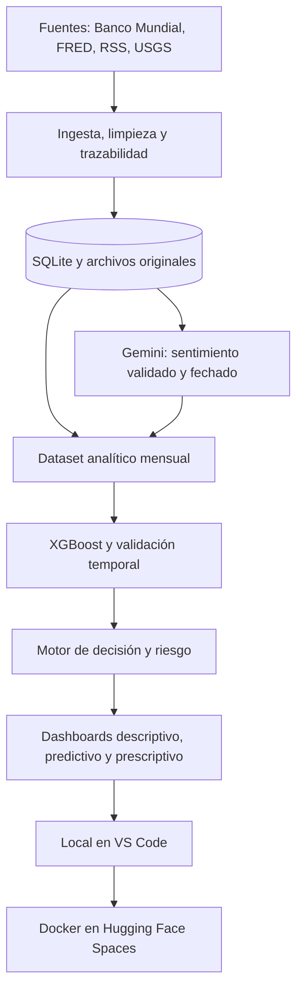

# SISTEMA DE ANALÍTICA PREDICTIVA PARA LA INVERSIÓN EN METALES PRECIOSOS

Proyecto académico de Machine Learning para oro y plata. Aprende con precios mensuales reales del Banco Mundial y cuatro indicadores de FRED. Produce una tendencia **Alcista / Neutral / Bajista**, probabilidades del modelo, riesgo por reglas y una señal orientativa. El dashboard muestra historia, predicciones, noticias y trazabilidad.

**Empieza por [la guía local para Visual Studio Code](docs/01_GUIA_LOCAL.md).** Todos los archivos ya están ubicados en esta carpeta. Los comandos se ejecutan desde su raíz.

Para abrir lo que ya está instalado en tu equipo, sigue [Inicio rápido desde VS Code](docs/10_INICIO_RAPIDO_VSCODE.md). Para llevarlo a otra computadora, usa [la guía del docente](docs/09_INSTALACION_DOCENTE.md) y el paquete con `INSTALAR.cmd` / `INICIAR.cmd`.

## Ejecución local en Windows

```powershell
python -m venv .venv
.\.venv\Scripts\python.exe -m pip install -r requirements.txt
.\.venv\Scripts\python.exe -m metals.cli run
.\.venv\Scripts\python.exe -m streamlit run app.py
```

Abre http://localhost:8501. Si el entorno `.venv` ya fue creado e instalado, empieza por el tercer comando. La primera ingesta requiere internet. Sin datos reales disponibles se muestra un error o un estado vacío, nunca una demostración con cifras fabricadas.

## Recorrido del sistema



## Archivos que vas a utilizar

| Archivo o carpeta | Responsabilidad |
|---|---|
| `app.py` | Aplicación Streamlit |
| `metals/config.py` | Fuentes, umbrales y lista de variables |
| `metals/ingest.py` | Descarga, normalización e importaciones |
| `metals/storage.py` | SQLite y registros de procedencia |
| `metals/features.py` | Variables técnicas, macro y objetivo temporal |
| `metals/sentiment.py` | Conexión Gemini y validación de evidencia |
| `metals/modeling.py` | Entrenamiento y evaluación |
| `metals/decision.py` | Predicción, riesgo y reglas de abstención |
| `metals/cli.py` | Comandos de ejecución |
| `tests/` | Pruebas de tiempo, etiquetas, datos y app |
| `data/` | Descargas, SQLite y dataset generado; no se versiona |
| `artifacts/gold/`, `artifacts/silver/` | Modelos JSON, métricas y predicciones generados |
| `docs/` | Guías, metodología, informe y guion de exposición |
| `scripts/package_space.py` | Paquete de publicación con archivos permitidos |

## Documentación

1. [Instalación y aprendizaje local](docs/01_GUIA_LOCAL.md).
2. [Fuentes, alternativas, diccionario y minería](docs/02_FUENTES_Y_DATOS.md).
3. [Solución de errores](docs/03_SOLUCION_ERRORES.md).
4. [Metodología y prevención de anticipación](docs/04_METODOLOGIA.md).
5. [Despliegue posterior en Hugging Face](docs/05_HUGGING_FACE.md).
6. [Informe académico](docs/06_INFORME_ACADEMICO.md).
7. [Guion de demostración y criterios de aceptación](docs/07_DEMOSTRACION.md).
8. [Resultados verificados de esta instalación](docs/08_VERIFICACION.md).
9. [Cinco noticias por metal y sentimiento](docs/11_NOTICIAS_Y_SENTIMIENTO.md).
10. [Mejora del modelo y métricas](docs/12_MODELO_Y_METRICAS.md).
11. [Fuentes específicas de noticias](docs/13_FUENTES_NOTICIAS.md).

## Alcance honesto

- El núcleo se puede ejecutar sin claves de APIs. Usa históricos revisados, con rezagos conservadores. Su evaluación **no es una reconstrucción certificada de la información publicada en cada fecha**.
- Noticias y producción forman parte del almacenamiento y dataset. Sólo entran en XGBoost si hay cobertura histórica suficiente en el primer bloque de entrenamiento; el reporte enumera las exclusiones. No se sustituye el historial ausente por ceros.
- Gemini requiere tu clave y puede consumir cuota. El comando explícito `sentiment` realiza el análisis. La web pública no hace llamadas de pago.
- La vista de noticias muestra sentimiento real guardado, relevancia, evidencia literal, fecha y modelo. `gemini-check` comprueba acceso sin imprimir la clave. Si se interrumpe un lote, conserva los artículos completados y reanuda los pendientes.
- La producción anual requiere importación verificable con fecha de disponibilidad. Se incluyen instrucciones y un esquema vacío, sin cifras inventadas.
- Las métricas se calculan al entrenar. No hay precisión prometida ni rentabilidad estimada. “Abstenerse” es una salida válida del sistema.
- El despliegue está preparado para hacerse **después de comprobar la aplicación local**, como parte de tu recorrido de aprendizaje.
